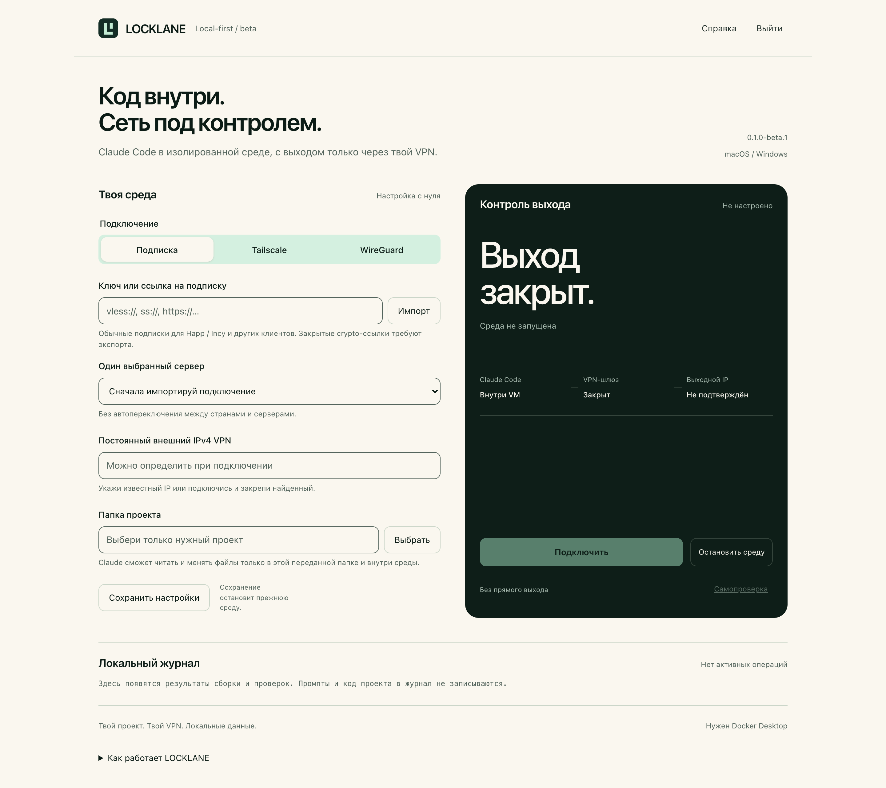

# LOCKLANE

**Код внутри. Сеть под контролем.**

Локальная среда для Claude Code на macOS и Windows: Linux внутри Docker Desktop, подключение своего VPN и сетевой kill switch внутри среды. На компьютере не меняются системные маршруты, DNS, файрвол и настройки обычного Claude.

> **0.1 beta.** Это устанавливаемая первая версия с открытым кодом. Проверки и границы перечислены ниже; универсальная совместимость и отсутствие любых утечек не обещаются.



[Скачать сборку для Mac или Windows](https://github.com/leoaic0nt3nt/locklane/releases/tag/v0.1.0-beta.1) · [Открыть PDF-гайд](https://github.com/leoaic0nt3nt/locklane/releases/download/v0.1.0-beta.1/LOCKLANE-Guide-RU.pdf)

## Быстрый старт

1. Установи [Docker Desktop](https://docs.docker.com/desktop/) и запусти Linux containers. На Windows нужен поддерживаемый Docker Desktop вариант WSL 2/Hyper-V; смотри [официальные требования](https://docs.docker.com/desktop/setup/install/windows-install/). На Mac выбери Apple silicon или Intel. У Docker Desktop есть собственные [условия лицензирования](https://docs.docker.com/subscription/desktop-license/).
2. Скачай ZIP под свою систему и архитектуру из Releases. Распакуй. На Mac открой `LOCKLANE.app`; на Windows — `LOCKLANE.exe`. Установщики `Install.command` / `Install.ps1` только копируют приложение в пользовательскую папку и добавляют доступ к нему, без системного автозапуска. Запуск из распакованного архива тоже подходит.
3. Открой настройки (кнопка справа вверху), раздел «Подключение». Вставь обычную VPN-подписку или ключ. Нажми «Импорт» и выбери **один** сервер. Либо используй WireGuard `.conf` или Tailscale exit node. Никакие ключи не нужно отправлять автору LOCKLANE.
4. В настройках, раздел «Среда», выбери папку проекта. Не передавай домашнюю папку: внутри выбранного проекта Claude сможет читать, менять и удалять файлы.
5. Сохрани настройки. На главном экране нажми круглую кнопку «Включить». Первая сборка загружает Linux-образы и Claude Code и зависит от скорости сети; готовые образы используются повторно. При Tailscale войди по появившейся официальной ссылке и разреши использование своего exit node.
6. Укажи заранее известный постоянный IPv4 либо дождись его определения и нажми «Закрепить» рядом с IP. До закрепления запуск Claude запрещён. Если адрес меняется, требуется явная перенастройка.
7. При статусе «Защита включена» запусти самопроверку в настройках, раздел «Журнал». Затем на главном экране нажми «Открыть Claude Code». Откроется терминал **внутри среды**; авторизуйся в Claude самостоятельно. Если OAuth требует системный браузер, его маршрут находится вне защиты LOCKLANE. Для него нужна отдельная сетевая защита. Данные входа CLI сохраняются в локальном Docker volume, не в репозитории.

На Mac первая версия подписана ad hoc, без Apple notarization. На Windows нет Authenticode-подписи. ОС может потребовать ручное разрешение запуска; не отключай Gatekeeper, SmartScreen или антивирус целиком. Нативную установку на Windows ARM и полный цикл перезагрузки каждой ОС нужно проверить на соответствующем устройстве до широкого выпуска.

## Какие VPN подходят

Обычные HTTPS-подписки со списком ключей, base64-списки, отдельные `vless://`, `vmess://`, `trojan://`, `ss://`, `hysteria2://` / `hy2://`, `tuic://`, `socks://`, WireGuard `.conf`, Tailscale exit node. Для VLESS/VMess доступны TCP/raw, WebSocket, gRPC, XHTTP и HTTPUpgrade в поддерживаемом наборе параметров. VLESS Reality обрабатывает Xray; Hysteria2 и TUIC — sing-box.

Названия Moriarty, Durev, Hit и других продавцов не являются протоколами. Совместимость определяется конкретным экспортом. Ссылка, работающая в Happ или Incy, **может** содержать неподдерживаемые закрытые настройки. Мы не заявляем, что проверили платные аккаунты этих провайдеров. Матрица, ограничения и способ экспорта — в [COMPATIBILITY.md](COMPATIBILITY.md).

Не загружай в публичный issue реальные ключи, подписки, QR-коды и журналы авторизации. Импорт идёт напрямую к провайдеру по HTTPS, без стороннего конвертера. Подписка загружается на хосте при настройке, до подключения контейнерного VPN. Провайдер подписки увидит сетевой адрес этого запроса. Сервер фиксируется; автообновления подписок, url-test и автоматического failover нет.

## Почему сеть не должна обойти VPN

```text
Выбранная папка ──► Claude Code, UID 1000, без capabilities
                         │
                         ▼
               Общий сетевой namespace шлюза
               ├─ iptables: внешний выход только в VPN-интерфейс
               ├─ отдельный проверяющий процесс, UID 1001
               ├─ закреплённый выходной IPv4
               └─ WireGuard / Tailscale / sing-box + Xray
                         │
                         ▼
                    Твой VPN-сервер
```

Шлюз устанавливает DROP до запуска VPN. Claude не получает NET_ADMIN, root, Docker socket, ключи VPN или домашнюю папку хоста. При исчезновении туннельного интерфейса его пакеты не проходят в `eth0`, даже если вернулся обычный маршрут. Подтверждённый IP открывает цепочку приложения атомарно. Работает отдельная проверка через туннель; неизвестное состояние и неправильный IP закрывают доступ. Обёртка запуска завершает свою сессию при утрате готовности.

IPv6 в beta закрыт полностью. Приватные сети, metadata endpoint, Docker DNS и внутренний SOCKS-мост недоступны рабочему UID. DNS приложения идёт через VPN; используется публичный резолвер 1.1.1.1 (для sing-box — DoH через выбранный outbound). Если провайдер блокирует этот DNS, подключение не будет готовым.

Системный LuLu для этой схемы не требуется. Ранее установленные правила и VPN на хосте не импортируются и не меняются. Продукт не управляет другими контейнерами и не переключает глобальный Docker context. Остановка касается только Compose-проекта `locklane`; его имя зарезервировано для одной среды LOCKLANE на этом Docker engine.

## Границы

- Защищён только Claude Code, запущенный здесь, и процессы внутри его контейнера. Claude Desktop, браузер, удалённые агенты и внешние программы хоста не входят в охват.
- Контейнеры находятся внутри Linux VM Docker Desktop. Это не отдельная персональная VM с отдельным ядром на каждый проект. Администратор хоста и администратор Docker могут читать/менять среду; другие программы с правами твоего пользователя могут читать его локальные настройки. Это не защита от заражённого хоста; компрометация ядра/гипервизора не входит в эту защиту.
- Выбранная папка общая с хостом и доступна для записи. Все находящиеся в ней секреты также видны Claude. Его локальный auth-volume содержит его учётные данные и доступен внутри среды.
- Фильтр фиксирует интерфейс; проверка выходного IP периодическая (обычно каждые несколько секунд). Если провайдер меняет NAT/IP **внутри работающего туннеля**, обнаружение не мгновенное. Мы не обещаем «ни одного пакета» при любых событиях, анонимность или защиту от бана.
- VPN не меняет [условия поддерживаемых регионов Anthropic](https://www.anthropic.com/legal/supported-regions), лицензию и оплату Claude.
- Автозапуска Claude нет. После перезагрузки Docker может восстановить только шлюз; рабочая сессия запускается пользователем после свежей проверки. Проверка служебного restart не заменяет настоящий холодный старт каждой поддерживаемой ОС.

## Проверки и разработка

`go test ./...` и `go vet ./...` проверяют импорт, запрет опасных профилей, mount-границы, токен панели, структуру Compose и запрет хранения ключа в обычном конфиге. CI запускает их на Linux, macOS и Windows. Linux integration создаёт отдельные синтетические WireGuard и Shadowsocks серверы, проверяет положительный маршрут, отказ IPv6/LAN/direct-interface, удаление туннеля, неверный IP и режим определения IP. Он не входит в Claude и не отправляет ему сообщения.

Реальный статус выполнения смотри в Actions и артефакте `network-proof.json`. Зелёная сборка бинарника не является проверкой native UI или перезагрузки Windows/Mac. [Протокол приёмки](docs/ACCEPTANCE.md) объясняет ручные проверки перед стабильным выпуском.

Собрать: Go 1.27.4, затем `go build .`. Пакеты: `python3 scripts/package.py`. Приложение не требует Go/Python на хосте получателя; Docker обязателен. `LOCKLANE_HOME` и `LOCKLANE_DOCKER_CONTEXT` предназначены для изолированного dev/CI; production автоматически ищет локальный Docker Desktop в `desktop-linux` / `default` и отказывает удалённым endpoints.

Команды: `locklane doctor`, `locklane run`, `locklane run --version`, `locklane stop`, `locklane version`. Для macOS CLI находится в `LOCKLANE.app/Contents/MacOS/LOCKLANE`.

## Данные и удаление

Настройки: пользовательский `Locklane` в Application Support (Mac) / AppData Roaming (Windows). VPN-профили лежат отдельно в `secrets`, с ограниченными правами файла на Unix. Панель слушает только 127.0.0.1, использует случайный локальный токен, проверяет Origin/Host и не имеет телеметрии.

Сначала выключи среду круглой кнопкой на главном экране или выполни `locklane stop`. Приложение и его папку настроек можно удалить вручную. Docker volumes с префиксом `locklane_` сохраняют авторизацию и VPN-состояние: удаляй **только их**, когда осознанно хочешь стереть эти данные. Файлы проекта не удаляются установщиком/деинсталлятором. Не запускай `docker system prune` для удаления LOCKLANE.

Код LOCKLANE — MIT. Зависимости и исходники — [THIRD_PARTY.md](THIRD_PARTY.md). Проект не связан с Anthropic, Happ, Incy или VPN-провайдерами.
